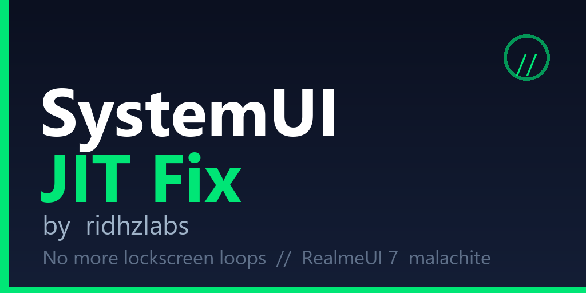

<div align="center">



# SystemUI JIT Fix

### Stop SystemUI restarts · Stop lockscreen loops

**by ridhzlabs**

[](https://github.com/ridhzlabs/SystemUI-JIT-Fix/releases)
[](https://github.com/ridhzlabs/SystemUI-JIT-Fix/releases)
[](https://github.com/ridhzlabs/SystemUI-JIT-Fix/releases)

[🇬🇧 English](#-english) · [🇮🇩 Bahasa Indonesia](#-bahasa-indonesia)

</div>

---

# 🇬🇧 English

## What is this?

A tiny root module that stops **SystemUI from crashing back to the
lockscreen every ~30–60 minutes** on the **RealmeUI 7 port for Redmi Note 14
Pro 5G (malachite)** — and on any ROM with the same symptom.

## What is inside?

| File | Purpose |
|---|---|
| `service.sh` | Runs on every boot: re-applies the fix (skips if already applied) |
| `action.sh` | Manual "Execute" button in the manager app |
| `module.prop` | Module metadata + `banner` + `updateJson` (auto-update) |
| `banner.png` | Banner shown in KernelSU Next manager |
| `META-INF/` | Universal installer (Magisk + KernelSU Next + APatch) |

No system files are replaced. No background service. Total size < 35 KB.

## How does the fix work?

Tombstone forensics (8 identical crashes) proved this is an **ART JIT
compiler crash**, not a normal app crash:

```
signal 11 (SIGSEGV), fault addr 0x30
thread "Jit thread pool" >>> com.android.systemui <<<
libart.so: HInliner → HInstructionBuilder (null dereference)
```

The JIT compiler tries to compile one hot method inside the repacked
SystemUI, and the compiler itself crashes (beta CANARY ART build). It is
deterministic — root modules and Play Integrity were both ruled out by
comparing crash timestamps against module install times.

The fix: **fully AOT-compile SystemUI (`speed` filter)**

```
cmd package compile -m speed -f com.android.systemui
```

With every method pre-compiled, the JIT never touches the crashing method,
so the compiler bug never triggers. This is a workaround, not an ART patch —
but it is stable, tiny, and fully reversible.

## Advantages

- ⚡ **Lightweight** — < 35 KB, one shell script, zero background processes
- 🔧 **Practical** — install once, the fix re-applies itself every boot
- 🔄 **Auto-update** — `updateJson` wired to GitHub Releases, update from the manager app
- 🛡️ **Safe** — touches no system files; uninstall = gone
- 📦 **Universal** — one zip flashes on Magisk, KernelSU Next, and APatch

## Tutorial

### Option A — Flash the module (recommended)

1. Download `SystemUI_JIT_Fix-vX.X.zip` from
   [Releases](https://github.com/ridhzlabs/SystemUI-JIT-Fix/releases).
2. **KernelSU Next:** Modules → Install from storage → pick the zip.
   **Magisk:** Modules → Install from storage → pick the zip.
3. **Reboot.**
4. Verify (adb or Termux):
   ```
   dumpsys package com.android.systemui | grep -m1 -o '\[status=[a-z-]*\]'
   ```
   Expected: `[status=speed]`
5. Use the phone normally for 2–3 hours — no more lockscreen loops.

### Option B — ADB only (no module, no root)

Same effect, repeat manually if dexopt ever resets:

```powershell
adb shell "cmd package compile -m speed -f com.android.systemui"
```

### Verify it worked

```
adb shell "logcat -b crash -d" | grep -i systemui   # must be empty
```

### Uninstall / revert

Remove the module in the manager app → reboot. To restore the default
compile filter: `cmd package compile -m verify -f com.android.systemui`.

## Who is this for?

- RealmeUI 7 port users on **malachite** (Redmi Note 14 Pro 5G) with periodic
  SystemUI restarts to lockscreen.
- Anyone with the same signature: `Jit thread pool` + `com.android.systemui` +
  `SIGSEGV fault addr 0x30` in tombstones.

## Credits

- Author: **ridhzlabs**
- Forensics: ART tombstone analysis on-device via adb

---

# 🇮🇩 Bahasa Indonesia

## Ini apa?

Module root super kecil yang menghentikan **SystemUI crash balik ke
lockscreen tiap ~30–60 menit** di **port RealmeUI 7 untuk Redmi Note 14 Pro 5G
(malachite)** — dan di ROM apapun dengan gejala yang sama.

## Isinya apa?

| File | Fungsi |
|---|---|
| `service.sh` | Jalan tiap boot: menerapkan ulang fix (skip kalau sudah teraplikasi) |
| `action.sh` | Tombol "Execute" manual di aplikasi manager |
| `module.prop` | Metadata module + `banner` + `updateJson` (auto-update) |
| `banner.png` | Banner yang tampil di manager KernelSU Next |
| `META-INF/` | Installer universal (Magisk + KernelSU Next + APatch) |

Tidak ada file system yang diganti. Tidak ada service background. Total < 35 KB.

## Cara kerja fix-nya gimana?

Forensik tombstone (8 crash identik) membuktikan ini **crash di ART JIT
compiler**, bukan app crash biasa:

```
signal 11 (SIGSEGV), fault addr 0x30
thread "Jit thread pool" >>> com.android.systemui <<<
libart.so: HInliner → HInstructionBuilder (null dereference)
```

JIT mencoba compile satu method panas di SystemUI hasil repack, lalu
compiler-nya sendiri yang crash (ART beta CANARY). Deterministik —
modul root dan Play Integrity sudah terbukti bukan pelaku via cek timeline
tombstone vs waktu install.

Fix-nya: **compile SystemUI penuh (AOT, filter `speed`)**

```
cmd package compile -m speed -f com.android.systemui
```

Karena semua method sudah pre-compile, JIT tidak pernah menyentuh method
pemicu crash, jadi bug compiler tidak kepicu. Ini workaround, bukan patch
ART — tapi stabil, kecil, dan sepenuhnya reversible.

## Keunggulan

- ⚡ **Ringan** — < 35 KB, satu shell script, nol proses background
- 🔧 **Praktis** — install sekali, fix teraplikasi otomatis tiap boot
- 🔄 **Auto-update** — `updateJson` tersambung ke GitHub Releases, update dari aplikasi manager
- 🛡️ **Aman** — tidak menyentuh file system; uninstall = hilang total
- 📦 **Universal** — satu zip bisa di-flash di Magisk, KernelSU Next, dan APatch

## Tutorial

### Cara A — Flash module (disarankan)

1. Download `SystemUI_JIT_Fix-vX.X.zip` dari
   [Releases](https://github.com/ridhzlabs/SystemUI-JIT-Fix/releases).
2. **KernelSU Next:** Modules → Install from storage → pilih zip.
   **Magisk:** Modules → Install from storage → pilih zip.
3. **Reboot.**
4. Verifikasi (adb atau Termux):
   ```
   dumpsys package com.android.systemui | grep -m1 -o '\[status=[a-z-]*\]'
   ```
   Harus keluar `[status=speed]`.
5. Pakai HP normal 2–3 jam — tidak ada lagi loop lockscreen.

### Cara B — ADB saja (tanpa module, tanpa root)

Efeknya sama, ulangi manual kalau dexopt ke-reset:

```powershell
adb shell "cmd package compile -m speed -f com.android.systemui"
```

### Verifikasi berhasil

```
adb shell "logcat -b crash -d" | grep -i systemui   # harus kosong
```

### Uninstall / revert

Hapus module dari aplikasi manager → reboot. Untuk kembalikan filter
default: `cmd package compile -m verify -f com.android.systemui`.

## Ini buat siapa?

- Pengguna port RealmeUI 7 di **malachite** (Redmi Note 14 Pro 5G) yang
  SystemUI-nya restart berkala ke lockscreen.
- Siapapun dengan signature sama: `Jit thread pool` + `com.android.systemui` +
  `SIGSEGV fault addr 0x30` di tombstone.

## Kredit

- Author: **ridhzlabs**
- Forensik: analisa tombstone ART langsung di device via adb

---
<div align="center">© ridhzlabs — SystemUI JIT Fix</div>
